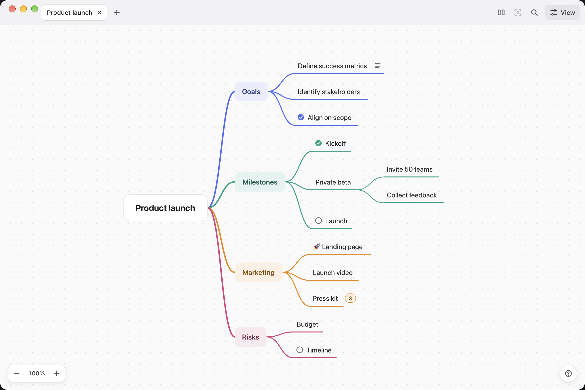
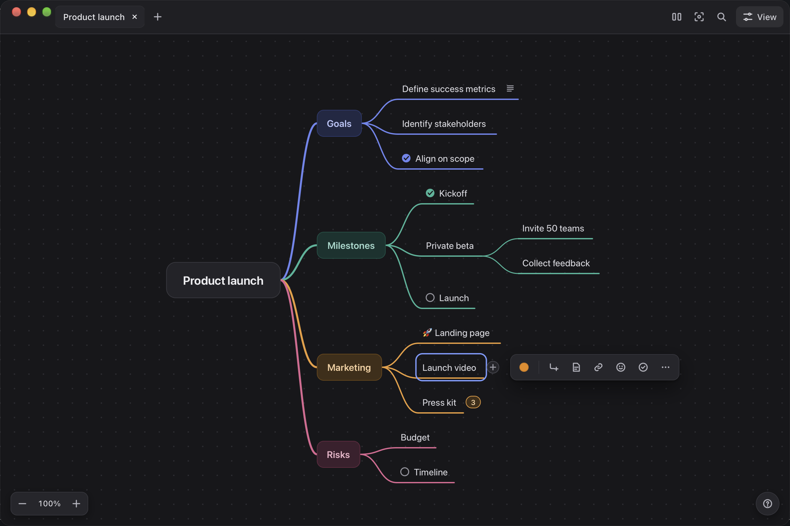

# Canopy

A simple, elegant mindmapping desktop app for thinking.

Canopy draws your ideas as a left-to-right tree. The root sits on the
left. Branches grow to the right, and each branch gets its own color.
You can add ideas fast, drag nodes where you want them, and arrange the
whole tree into neat, even columns with one click.





## Download

Get the latest build from the
[Releases page](https://github.com/tilakp/canopy/releases).

Pick the file for your system:

| System | File |
|---|---|
| macOS (Apple Silicon) | `Canopy_aarch64.dmg` |
| macOS (Intel) | `Canopy_x64.dmg` |
| Windows | `Canopy_x64-setup.exe` (or the `.msi`) |
| Linux | `.AppImage` or `.deb` |

These builds are not code-signed or notarized, so your OS will warn you
before the first launch:

- **macOS**: right-click (or Control-click) the app and choose **Open**,
  then confirm in the dialog. Opening it normally from Finder will
  refuse to launch, since macOS blocks unsigned apps by default.
- **Windows**: click **More info**, then **Run anyway** on the
  SmartScreen prompt.

## Features

- Add a child (Tab) or a sibling (Enter, placed right after the selected
  node). While you type a new node, Enter goes on to the next sibling and
  Tab to a child, so you can list ideas without leaving the keyboard.
  Escape on an empty new node removes it.
- Edit the selected node with F2 or Space, or double-click it. Hover a
  node and click its **+** button to add a child.
- Press `?` (or the **?** button in the bottom-right corner) to see every
  keyboard shortcut.
- Press `⌘K` to search every command, with its shortcut.
- Click a node to get a small toolbar next to it: branch color, add child,
  notes, link, icon, checklist status, and more. Right-click a node for all
  of its actions, or right-click the empty canvas for undo, Arrange and
  zoom.
- Delete the selected node (Delete/Backspace) along with its subtree.
- Navigate with arrow keys: Up/Down between siblings, Left to the parent,
  Right to the first child. Reorder siblings with Alt+Up/Down.
- Drag a node to reposition it, or drop it onto another node to reparent
  it there. Click **Arrange** in the title bar to undo all manual moves,
  give every box in a column the same width and line the columns up, or
  click the zoom level in the bottom-left corner (or press `0`) to fit
  the whole tree in the window.
- Fold a branch with the **−** that appears when you point at a node with
  children, or press `.`. A folded branch shows how many ideas it hides;
  click that number (or press `→`) to open it again. Option-click folds or
  opens every level below.
- Add notes (`N`), a link (`L`), an icon/emoji (`I`), or a checklist status
  (`T` cycles todo/done) to the selected node. Notes and links show as small
  icons in the node: point at the notes icon to read the notes, or click it
  to edit them, and click the link icon to open the link in your browser.
- Select multiple nodes with shift+click for bulk recolor, bulk delete, or
  dragging the whole group together.
- Find a node with `⌘F`; jump between matches with the arrows next to it.
- Press `F` (or the focus button in the title bar) to focus on a branch,
  dimming everything else.
- Paste an image from your clipboard onto the selected node.
- Work on multiple maps at once in tabs in the title bar, or start a new
  one from a starter template with **+**.
- Pan (drag empty canvas) and zoom (scroll wheel, or the zoom control in
  the bottom-left corner).
- Recolor a branch from the node toolbar or the right-click menu,
  including a custom color picker.
- The **View** menu in the title bar holds the settings for how maps
  look: light, dark, or follow the system appearance; curved or elbow
  lines; the font (including a hand-drawn one); a hand-drawn "sketchy"
  style; the dot grid; and a minimap for larger maps.
- Nodes slide to their new places when you add, move, fold or arrange
  them (off when macOS asks for reduced motion).
- Undo/redo (⌘Z / ⌘⇧Z) for every change.
- Save (⌘S), Save As (⇧⌘S) and open (⌘O) `.canopy` files, a plain JSON
  format. On macOS these are in the menu bar's File menu, which also has
  New (⌘N), Open Recent, Import Markdown, Export (⇧⌘E) and Print (⌘P). On
  Windows and Linux, the **File** button in the title bar has the same
  items. On macOS, double-clicking a `.canopy` file opens it directly in
  Canopy. A dot on a tab's close button marks unsaved changes. Before you
  close or replace unsaved work, Canopy asks whether to Save, Don't Save
  or Cancel.
- Import a Markdown outline, or export the current map as PNG, SVG, or a
  Markdown outline. [`docs/example.canopy`](docs/example.canopy) is a
  small example map to open.

## Development

Requires [Bun](https://bun.sh) and the
[Tauri prerequisites](https://v2.tauri.app/start/prerequisites/) for your
platform (a Rust toolchain, plus platform build tools).

```sh
bun install
bun run tauri dev   # launch the desktop app (first run compiles Rust deps, ~1min)
bun run test        # vitest, jsdom environment
bunx tsc --noEmit    # type-check
```

The dev app does not read or write any file by default. It boots a
small starter tree so you can jump straight into your own map.

## How it works

| File | Responsibility |
|---|---|
| `src/model.ts` | The tree data structure and pure mutation helpers. |
| `src/layout.ts` | Computes every node's position from the tree. |
| `src/textwrap.ts` | Measures and wraps node text. |
| `src/render.ts` | Draws the tree as SVG, including the hand-drawn "sketchy" style, multi-select highlighting, and focus-mode dimming. |
| `src/visuals.ts`, `src/colors.ts`, `src/edges.ts`, `src/camera.ts` | Node sizes and styles, the palette and theme colors, line geometry, and the camera. |
| `src/editors.ts` | The title, notes, icon and link editors. |
| `src/motion.ts` | Nodes sliding to new places, and the drag preview. |
| `src/app.ts` | Owns UI state and every event listener for one map. |
| `src/commands.ts` | Every action, defined once, with its shortcut. |
| `src/document.ts` | A map's tree, file, undo history and unsaved state. |
| `src/titlebar.ts` / `src/workspace.ts` | The title bar (tabs, Arrange, Focus, Find, View, File) and multi-map coordination. |
| `src/toolbar.ts` | The zoom control, the help button and the node toolbar. |
| `src/menu.ts` | Popovers and the right-click menu. |
| `src/palette.ts` | The `⌘K` command palette. |
| `src/prefs.ts` | View settings shared by every map (lines, hand-drawn style, grid, minimap). |
| `src/icons.ts` | The icon set. |
| `src/history.ts` | Undo/redo stack. |
| `src/persistence.ts` | Save/load to a local `.canopy` file. |
| `src/exportFile.ts`, `exportImage.ts`, `exportMarkdown.ts` | Export to PNG/SVG/Markdown. |
| `src/importMarkdown.ts` | Import a Markdown outline as a map. |
| `src/printMap.ts` | Print the current map. |
| `src/recentFiles.ts` | The Open Recent list. |
| `src/templates.ts` | Starter templates for the "+" button. |
| `src/theme.ts` | Light, dark, or the system appearance. |
| `src/fonts.ts` | The font picker. |
| `src/search.ts` | The find bar (`⌘F`). |
| `src/minimap.ts` | The navigable minimap. |
| `src/help.ts` | The keyboard shortcut list (`?`). |
| `src/dialogs.ts` | The unsaved-changes and save-error dialogs. |
| `src-tauri/` | The Tauri (Rust) shell: window, file dialogs, file system access, and file-association handling. |

See `CLAUDE.md` for the design decisions behind these files and a list of
known bugs worth remembering.

## Releasing a build

Push a tag matching `v*` (for example `v0.2.0`) to trigger
`.github/workflows/release.yml`. It builds Canopy for macOS
(Apple Silicon and Intel), Windows, and Linux, then publishes the
installers to a new GitHub release under that tag.

```sh
git tag v0.2.0
git push origin v0.2.0
```
